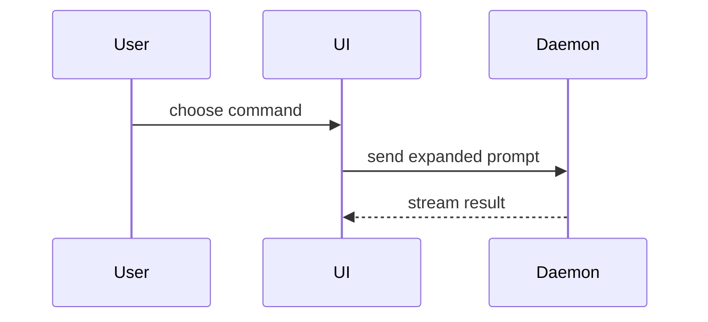

<!-- Factory adaptation of mattpocock-skills 1.3.1 `pr` (MIT); credits in CREDITS.md. Changed: Factory sections (Summary, Validation,
Risk), the Factory marker and the direct publication procedure; the Summary guidance is unchanged. -->

> Factory: draft the body any time; publish ONLY inside a publication activation requested by the Factory (section "Factory publication").

Use this template for writing the PR body (keep it short; the first line is the Factory marker given by the publication request):

```markdown
<!-- software-factory:work:<work-id> -->
## Summary

<what changes and why, in one or two sentences; diagram, diff-sketch, or tree when it helps>

Closes #<ticket-number>

## Validation

<synthesis: the gates you ran with their real results, as the Factory verified them; limitations; waivers with their authorization>

## Risk

**Door:** <one-way or two-way> — **Blast Radius:** <one-word description>

<what a human reviewer must look at before merging>
```

Never put transcripts, long command output, review rounds or full reviewer opinions in the body: they stay in the Factory records.
Never present a local path (`/artifacts/...`, `/workspace/...`, `file://`) as a link: it is not reachable remotely. Link only remote URLs.

## Sections

Skip all preambles and keep prose brief. Use the user's domain language from `GLOSSARY.md`.

### Summary

Pick the smallest view that makes the key point clear.

- Show logic or an algorithm as pseudocode:

```text
on(save)
  if content is unchanged
    return cached result
  write new content
  return fresh result
```

- Show runtime control flow as a call tree:

```text
submitForm
  createSession
    persistPrompt
    launchAgent
  navigateToSession
```

- Show UI structure as a component tree, including state and module boundaries that matter:

```text
<SessionPage> (apps/example/src/routes/session.tsx)
  useSessionEvents()
  <SessionToolbar>
    <RunSkillButton> (packages/ui)
```

- Show file responsibility or a broad refactor as a shallow file tree:

```text
src/
├── commands/       # parses user actions
├── sessions/       # owns session state
└── transport/      # sends API requests
```

- Show component interaction, control flow, or data flow with Mermaid:



- Use `diff` when the point is what changes and the surrounding shape already exists. Match the diff shape to the topic.

For a component change:

```diff
 <SessionPage>
   useSessionEvents()
   <SessionToolbar>
+    <RunSkillButton />
   <SessionTimeline>
+    <SkillResultCard />
```

For a file-layout change:

```diff
 src/
 ├── commands/
+│   └── show-me.ts       # expands the slash command
 ├── sessions/
-└── transport.ts
+└── transport/
+    ├── client.ts
+    └── stream.ts
```

For a call-tree or call-stack change:

```diff
 submitForm
   createSession
     persistPrompt
+    expandSkillMention
     launchAgent
-  navigateToSession
+  navigateToSession
+    subscribeToEvents
```

For a state or control-flow change:

```diff
 on(save)
-  write content
+  if content is unchanged
+    return cached result
+  write new content
+  invalidate cache
```

- Show the whole block when most of it is new, when omitted context would hide ownership or order, or when the user needs a copyable target shape:

```ts
function expandSkill(command: string): string {
  const skillName = command.slice(1);
  return `use the ${skillName} skill`;
}
```

#### Guidance

Place each visual next to the short text it supports. Keep only the calls, files, props, states, and boundaries needed to answer the user's current question or the options to resolve the current discussion point.

You may use one of these, you may use several, it is unlikely you will use all of them. Use your judgement and don't overwhelm the user.

### Validation

Summarize the evidence that the change works: the documented gates you ran and their real results (exactly as the Factory request states
them), what was not run and why, and any waiver with its concrete authorization. A waiver never satisfies a GitHub required check.
Keep it to a few lines; the detailed records stay with the Factory.

### Risk

Describe whether it's a one-way or two-way door. You can walk back through two-way doors, but not one-way doors. A PR that is cheap to roll back is lower risk. Changes that involve destructive actions or hard-to-reverse decisions are one-way doors.

The blast radius is the potential impact or scope of the changes introduced by this PR. Consider all possibilities. Examples are layout shift, breakages for consumers, mobile responsiveness, etc.

## Factory publication

Only inside a publication activation (a `publish` message or a "Factory publication instruction"), with the facts it gives you:

1. Write the body to `/artifacts/publication/pr-body.md`, first line the marker, with `Closes #<ticket-number>`.
2. Do not change the checkout: HEAD stays the verified commit.
3. Push exactly as the request says (`git -C /workspace/checkout push --force-with-lease=refs/heads/<branch>:<expected> origin <commit>:refs/heads/<branch>`),
   once, or not at all when the remote already holds the commit.
4. `gh pr list --repo <repo> --head <branch> --state all --json number,url,isDraft`: if a pull request exists, do not create another.
5. Otherwise, once: `gh pr create --repo <repo> --draft --base <base> --head <branch> --title "<short title>" --body-file /artifacts/publication/pr-body.md`.
6. Never merge, approve, mark ready, close, push elsewhere, use a plain force push, or edit labels/assignees/other pull requests. On a failure
   or an unclear outcome, inspect instead of repeating, and report. The Factory discovers the publication itself.
